# Amber Ledger

Hi everyone! I made **Amber Ledger** — an offline **task manager + personal finance tracker for
Android**. No account, no cloud, no ads: everything stays on your phone.

It all started because I kept forgetting when my doctor appointments were. One reminder app turned
into tasks, money, work shifts and widgets — and now my head is a lot lighter.

## ⬇️ Download

**[Download Amber-Ledger.apk](https://github.com/sakurasso12/Amber-ledger/releases/latest/download/Amber-Ledger.apk)**

Open the file on your phone and allow installing from this source when Android asks. Updates
install over the previous version and keep your data. I publish a new APK in
[Releases](https://github.com/sakurasso12/Amber-ledger/releases) every time there's a fix, even a
small one.

## 📱 Screens

### Tasks
Add any task you want: deadline with a reminder, priority, tags, subtasks, repeat rules and a
photo. Swipe a task to complete or delete it, hold to select several at once.

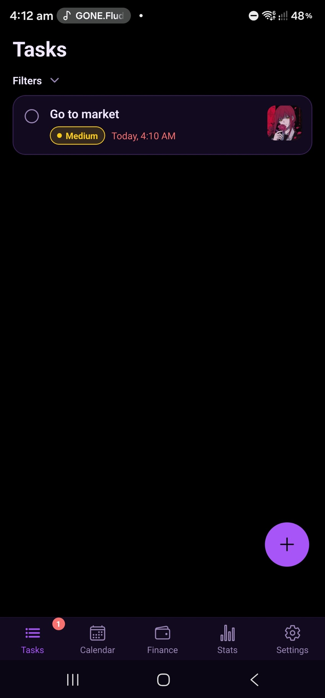

### Calendar
Your month at a glance — days with tasks and expenses are marked; tap a day to see everything on it.
It's also your history: every day keeps what you finished, what you added and what you spent.

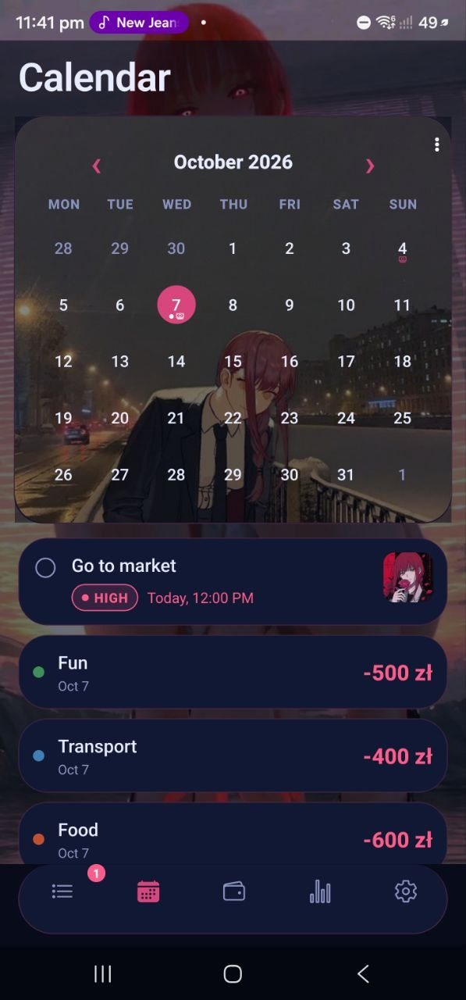

### Finance
What's in your account and what's actually free after your plans, salary that's still on its way,
a calendar of your work shifts with earnings, planned spending, recurring expenses and categories.
The app asks on payday whether your salary has actually arrived before it counts it. The expense
list shows the current month and starts fresh on the 1st — nothing is deleted, the history stays
in Calendar.

| Finance | New expense |
|:---:|:---:|
| 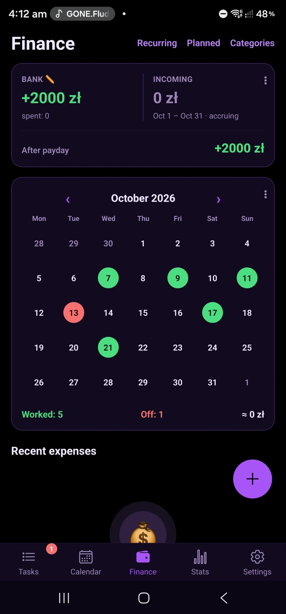 | 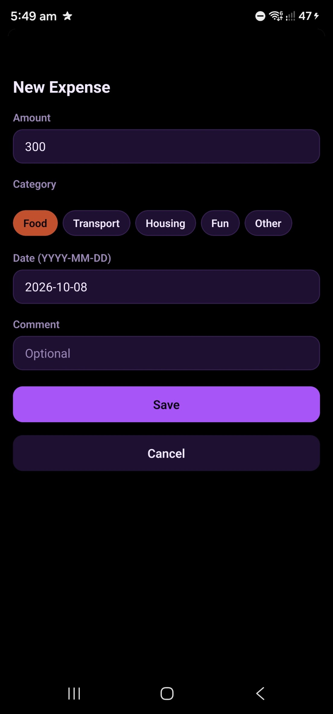 |

### Stats
Tasks created, completed and overdue per week; earnings per week and spending by category.

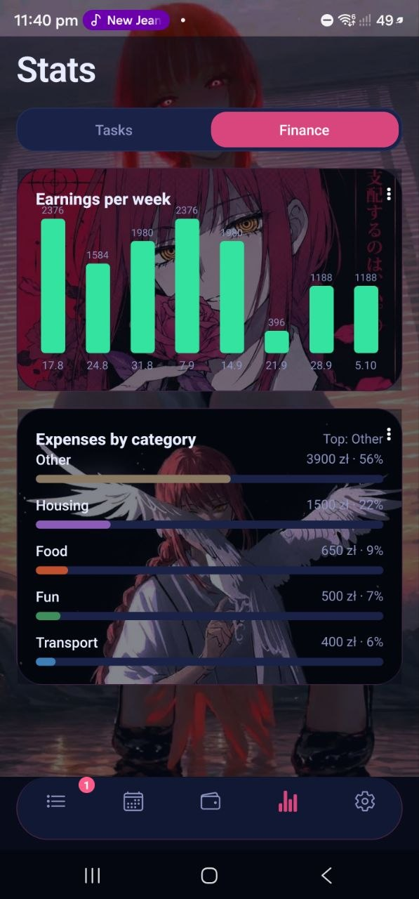

## ✨ Features

### 🔥 Habits & streaks
Turn on **Count streak** for a task that repeats every day or on certain weekdays, and it becomes
a habit card at the top of Tasks: the flame with your streak, dots for the last few times, and a
tap to mark today done. Only the scheduled days count, so a Mon/Thu habit isn't broken by Tuesday.
Each habit can have its own photo — and a small **1×1 streak widget** for the home screen shows
it too (tap the widget to choose which habit it follows).

### 🌊 Planned spending
Set a limit for something you buy all month — say, food for 800 zł. The whole limit comes off your
balance at once, then you tick off each purchase and a bar fills up with a wave in your theme
colour. Go over the limit and it turns red (110 %, 120 %…), with the extra logged as its own red
expense. On the 1st it starts over by itself; at the end of the month you can set next month's
limit. Changing a limit asks for your password.

### 🎯 Level ring
Every task you finish fills one segment of a ring of 10, with a little sound. Ten tasks — the ring
fills up and starts again: 7/10, then 10/20, 20/30…

### ✋ Arrange it your way
Tap the ✏️ pencil on Tasks, Finance, Stats or Calendar and the cards become movable: hold one,
drag it where you like, and it lands with a jelly wobble. Task cards come in three sizes
(half-width square, row, big card), most Finance and Stats cards can be full or half width, and
every card can have its own corners — square, rounded, round or leaf-shaped. Don't need a card?
Remove it with **−**; the **⋮** next to the pencil brings it back.

### 👋 First launch
A short setup the first time you open the app. First it asks whether you're moving from another
phone — if so, scan its QR and you're done. Otherwise: pick your language, create your profile, and
get a quick tour of what each screen does. After every update a few cards show what's new.

### 📦 Your data
Everything lives only on your phone — no accounts, no servers. In *Settings → Security & storage*:

- **Move to another phone by QR:** the old phone shows a code, the new one scans it and pulls your
  tasks, finances and profile straight over Wi-Fi, encrypted with a one-time key that exists only
  in that QR. Photos stay behind.
- **Auto clean-up** of done tasks and expenses older than 1–12 months, if you want it.
- **Erase** tasks, finances, your profile or everything — erasing everything asks twice, counts
  down from 10 and wants your password.

### 🔔 Notifications
Reminders before deadlines, a pinned notification for important tasks, budget alerts and a
payday reminder.

### 🛡️ Savings cushion
A card in Finance for your savings account: enter the balance, the interest rate and the date you
opened it — it shows when the account's year ends and roughly how much you'll have by then
(monthly capitalisation, before tax on interest). It starts as a blurred question, so it only
appears if you want it.

| Savings card | Setting it up |
|:---:|:---:|
| 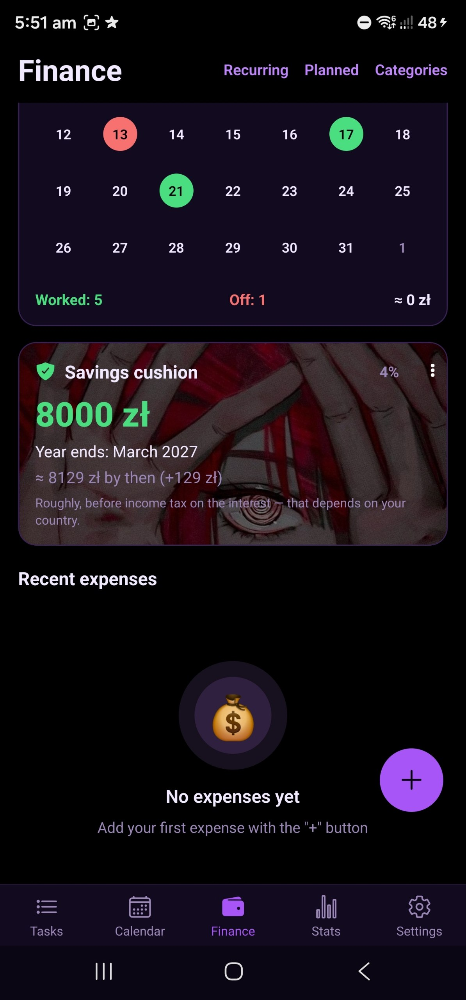 | 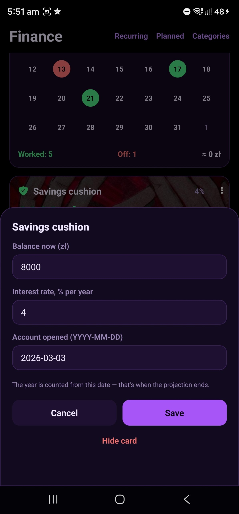 |

### 🎨 Almost everything is customizable
Everything about the look can be changed — except the font (coming soon):

- **Two layouts:** Standard, or Vertical — titles spelled down a rail on the left, the nearest
  task as a big *In focus* card with its photo as the background, a pill tab bar
- **Theme styles:** Amber, Neon, Paper — plus **light / dark / system** mode and an **accent colour**
- **Backgrounds:** your own picture behind the whole app, and a separate picture for any card
  (calendar, balance, charts…)
- **Home screen widgets:** today's tasks and spending, next task, next day off — each with its
  own background
- **Language:** English, Russian, Ukrainian
- Smooth, spring-based animations everywhere

| Standard | Vertical | Themes | Widgets |
|:---:|:---:|:---:|:---:|
|  | 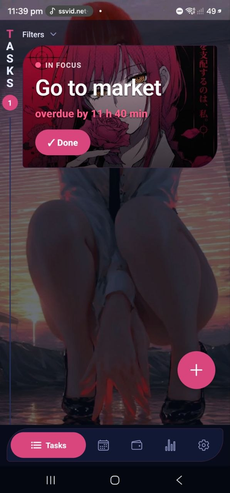 | 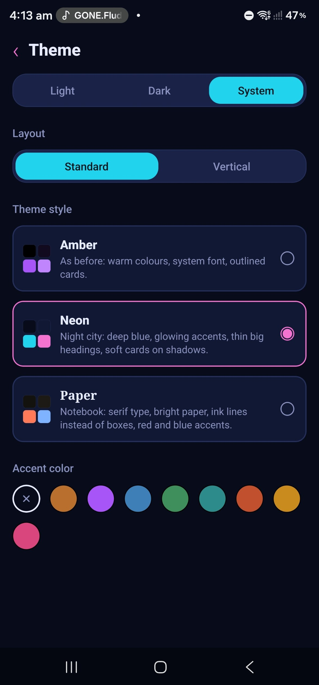 | 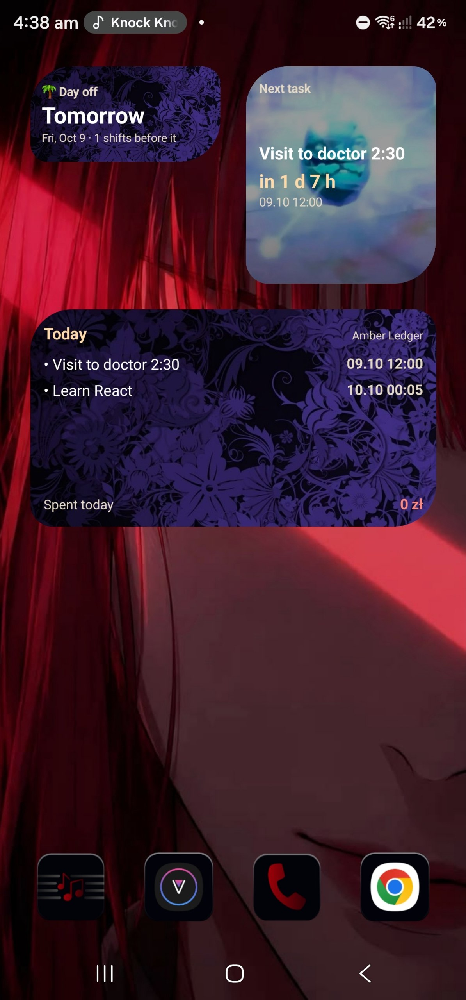 |

### 🔒 Security
Your money is nobody else's business. Turn on **Finance lock** in *Settings → Security & storage* and every
amount — Finance, Stats, Calendar and the widget — stays blurred until you unlock it with:

- your **fingerprint or phone PIN / pattern** (face unlock works too on phones that support it, e.g. Samsung),
- or your **profile password**.

It locks again after the time you choose (0–30 minutes after unlocking; 0 = as soon as you leave
Finance). The profile password is never stored — only a salted hash kept in Android's encrypted
Keystore.

| Locked | Security settings | Profile |
|:---:|:---:|:---:|
| 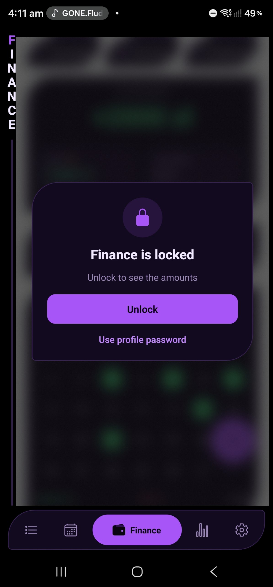 | 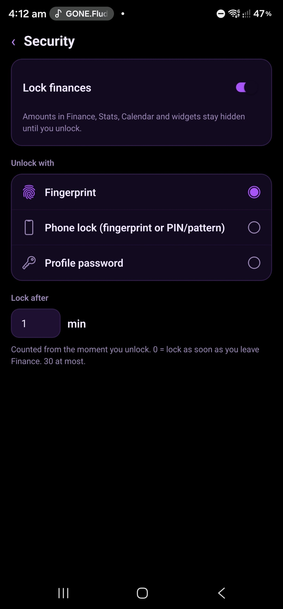 | 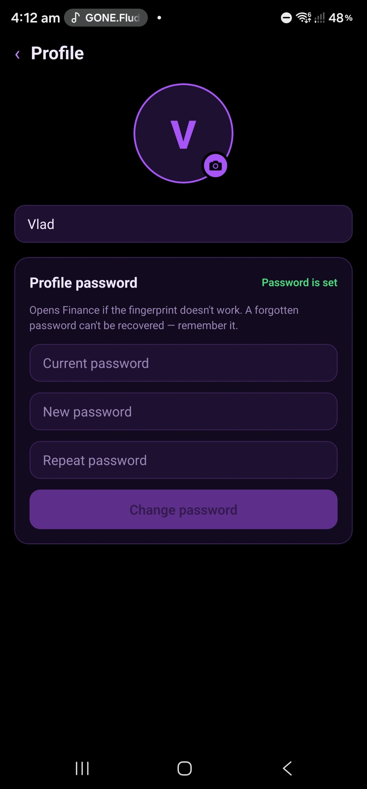 |

## 🛠️ How it's built

- **React Native + Expo** (SDK 57), **TypeScript**, routing with **expo-router**
- **SQLite** (expo-sqlite) for storage, **zustand** for state
- Own UI kit, charts and calendar (react-native-svg) — no UI or chart libraries
- Animations with **Reanimated**, drag & drop with **react-native-sortables**, sounds with **expo-audio**
- Phone-to-phone transfer: a small native module of its own in Kotlin (Expo Modules API) with
  AES-256-GCM, QR codes with **expo-camera** and **react-native-qrcode-svg**
- Tests for the money rules, streaks and the transfer with **jest-expo** (`npm test`)
- APKs are built with **EAS Build**

The idea, the design, every feature and every change to the interface are my own initiative —
and I tested all of it on a real phone. I'm a beginner developer and a student, so I can't know
everything yet: **Claude (Anthropic's AI assistant)** was my mentor and pair programmer. It
explained what I didn't know and helped me keep the project moving while I was at work.

## 🚀 Run it yourself

**Just want to use it?** Download the [APK](#️-download) — that's all.

**Want to run the code?**

1. Install [Node.js](https://nodejs.org) (LTS) and [Git](https://git-scm.com).
2. Clone and install the dependencies:
   ```sh
   git clone https://github.com/sakurasso12/Amber-ledger.git
   cd Amber-ledger
   npm install
   ```
3. Start the dev server and scan the QR code with **Expo Go** on your phone (same Wi-Fi):
   ```sh
   npx expo start
   ```
   Expo Go can't run home screen widgets, notifications, the pinned notification or moving data
   between phones — everything else works. For those, make your own build (below).
4. Run the tests:
   ```sh
   npm test
   ```

**Want to build your own APK?**

1. Create a free account at [expo.dev](https://expo.dev).
2. Install the EAS CLI and log in:
   ```sh
   npm install -g eas-cli
   eas login
   ```
3. Link the project to **your** account. It's linked to mine by default, so first delete
   `"owner"` and `"extra": { "eas": { "projectId": ... } }` from `app.json`, then run:
   ```sh
   eas init
   ```
4. Build an installable APK in Expo's cloud:
   ```sh
   eas build --platform android --profile preview
   ```
   When it's done you get a link to download the `.apk`.

## 📄 License

[MIT](LICENSE)
